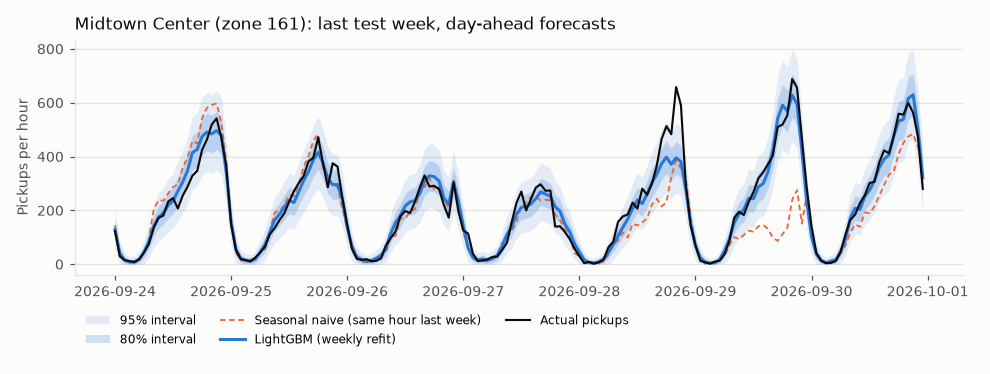
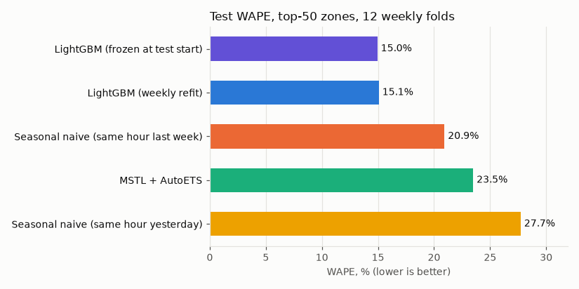
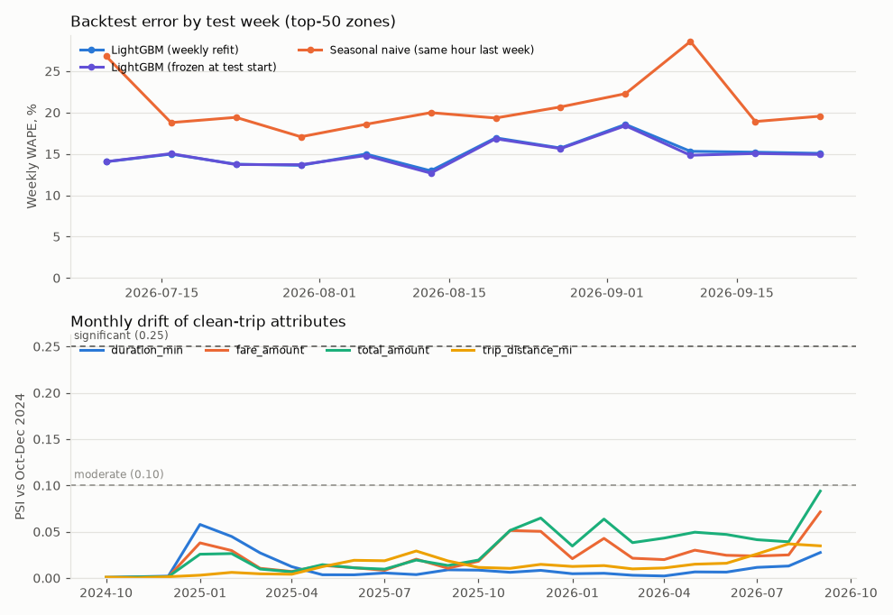

# nyc-demand-forecast

**Day-ahead hourly NYC yellow-taxi demand forecasts for the 50 busiest taxi zones, built as an
orchestrated pipeline: idempotent ingestion → dbt-duckdb warehouse with data-quality tests →
Dagster assets → LightGBM vs statistical baselines in a rolling-origin backtest → conformal
intervals → drift monitoring.**

## The problem

A dispatcher (or a fleet / pricing team) needs tomorrow's pickups per zone and hour, issued every
night, with an honest error bar. Getting there takes a platform as much as a model. The raw TLC
feed is about 93M rows over 24 months, its schema drifts, and it contains vendor-specific
reporting quirks. A naive cleaning rule would silently delete real demand. The forecast has to be
evaluated the way it would actually run, with no future information, and somebody has to notice
when the inputs or the error start to drift.

## Architecture

```
 NYC TLC CloudFront (24 monthly Parquet, zone CSV)     Open-Meteo (observed + day-2 forecasts)
            │  idempotent download: size check, MD5/ETag where possible, SHA-256 manifest
            ▼
 D:/…/raw/*.parquet ──► DuckDB  raw.*  (zero-copy views over Parquet; 3 GB memory cap)
                              │
                 dbt-duckdb   ▼   (65 data tests, all run on every build)
   staging  stg_tlc__yellow_trips · stg_tlc__taxi_zones · stg_open_meteo__weather_{observed,forecast}
   intermediate  int_trips__validated (dedup + first-failed quality rule) → int_trips__clean
                 → int_demand__zone_hour_counts
   marts    fct_hourly_zone_demand (263 zones × 17,520 h) · dim_zones · dim_calendar_hourly
            · dim_weather_hourly · rpt_trip_quality · rpt_vendor_anomalies
                              │
 Dagster  ────────────────────┼────────────────────────────────────────────────────────────
   raw_* assets ─► dbt assets ─► training_series ─► model_selection ─► backtest_results ─► drift_report
   (+ asset checks: months complete,                (validation      (rolling origin,      (PSI, error
    feed freshness, series structure,                weeks only)       conformal, MLflow)    over time,
    causality audit, coverage, drift)                     └──────► trained_model (MLflow)    figures)
```

Everything heavy (raw Parquet, `warehouse.duckdb`, MLflow `mlflow.db` + artefacts, predictions)
lives under `$ML_DATA_ROOT/forecast` and `$ML_MODELS_ROOT/forecast`. The repo holds only code,
dbt models and small `reports/`.

## Results

**Scope.** Test period = 12 weekly folds with 84 daily origins (23:00 local, 2026-07-08 → 2026-09-29),
24 hourly steps each, for the 50 busiest zones (100,800 forecast points) and the citywide total
(2,016 points). The objective and the weather switch were chosen on 4 earlier validation weeks
(2026-05-13 → 06-09), the next 4 weeks only warm up the conformal calibration, and the test folds
were scored once. Single laptop, CPU only. Every number below is read from the file named in
brackets; `→` marks the JSON key.

### Day-ahead accuracy, top-50 zones [`reports/backtest_metrics.json` → `groups.zones.test_metrics`]

| Model | WAPE | MASE | sMAPE |
|---|---|---|---|
| **LightGBM, global over zones, weekly refit** (Tweedie, no weather) | **0.1508** | **0.6478** | **0.2191** |
| LightGBM frozen at test start (no refit for 12 weeks) | 0.1495 | 0.6427 | 0.2179 |
| Seasonal naive, same hour last week (**baseline**) | 0.2093 | 0.8929 | 0.2951 |
| MSTL + AutoETS (statsforecast), fitted once per fold, 1-7 day lead ¹ | 0.2349 | 0.9633 | 0.4084 |
| Seasonal naive, same hour yesterday | 0.2773 | 1.1630 | 0.3700 |

- LightGBM vs the weekly seasonal naive: WAPE 27.95% lower, MASE 27.45% lower, better in 12 of 12
  test weeks and in 50 of 50 zones (`→ groups.zones.lgbm_vs_seasonal_naive_168h`). Per-zone WAPE
  ranges from 0.117 (z140) to 0.258 (z074), median 0.154 (`reports/backtest_per_series_zones.csv`,
  column `wape_lgbm`).
- ¹ A daily MSTL refit for 51 series × 84 origins did not fit the time budget, so MSTL is fitted on
  each fold's first origin and forecasts the whole week. That handicaps it on days 2-7. On the
  **fair day-1-only subset** (the first origin of each fold, 14,400 points) the order holds:
  LightGBM 0.1460, seasonal naive 24 h 0.1754, MSTL 0.1886, seasonal naive 168 h 0.2090 WAPE
  (`→ groups.zones.test_metrics_first_origin_of_each_fold`).
- Refit vs frozen: the frozen model is marginally better on zones (0.1495 vs 0.1508), so weekly
  refits buy nothing measurable over this 12-week window (see drift below).

### Citywide total [`reports/backtest_metrics.json` → `groups.citywide.test_metrics`]

| Model | WAPE | MASE | sMAPE |
|---|---|---|---|
| **LightGBM, weekly refit** (Poisson, with day-2 weather forecasts) | **0.0828** | **0.5530** | **0.0899** |
| LightGBM frozen at test start | 0.0849 | 0.5671 | 0.0932 |
| Seasonal naive, same hour last week (**baseline**) | 0.1257 | 0.8394 | 0.1319 |
| Seasonal naive, same hour yesterday | 0.1789 | 1.1941 | 0.2257 |
| MSTL + AutoETS, fitted once per fold, 1-7 day lead | 0.2311 | 1.5432 | 0.2868 |

WAPE 34.12% lower than the weekly seasonal naive, better in 11 of 12 test weeks
(`→ groups.citywide.lgbm_vs_seasonal_naive_168h`).

### Prediction intervals [`reports/backtest_metrics.json` → `groups.*.intervals`]

Online split-conformal on normalised residuals (trailing 28 days, causal):

| Series | Nominal 80% | Nominal 95% | n |
|---|---|---|---|
| Top-50 zones | 0.7992 | 0.9484 | 100,800 |
| Citywide | 0.8036 | 0.9499 | 2,016 |

Marginal coverage is on target, but it is not uniform by hour: for zones the 80% band covers
0.686 of 18:00 values and 0.907 of 04:00 values (`→ groups.zones.interval_coverage_by_hour.80`).

### Model selection on validation weeks [`reports/model_selection.json` → `groups.*.candidates`, `weather_ablation`]

| Candidate (validation WAPE) | Zones | Citywide |
|---|---|---|
| LightGBM Tweedie (p = 1.2) | 0.1461 | 0.0813 |
| LightGBM L1 | 0.1467 | 0.0816 |
| LightGBM L2 | 0.1474 | 0.0807 |
| LightGBM Poisson | 0.1487 | **0.0789** |
| Best objective without weather features | **0.1458** | 0.0810 |
| Seasonal naive 168 h | 0.2351 | 0.1603 |

Weather forecasts did not help the zone model (0.1458 without vs 0.1461 with), so it ships without
them. They helped the citywide model slightly (0.0789 vs 0.0810).

### Data quality [`reports/data_quality.json`, `reports/dbt_build.json`]

| | Rows |
|---|---|
| Raw trips, 24 monthly files (1.60 GB, `data_ingestion_trips.json` → `bytes_total`) | 93,450,512 |
| exact duplicates | 10 |
| pickup outside the file's month | 506 |
| invalid duration (missing, negative, > 6 h, or zero time and zero distance) | 61,950 |
| negative total amount | 1,342,398 |
| unknown pickup zone (264/265) | 185,895 |
| implausible distance (> 100 mi) | 4,352 |
| **Clean trips** | **91,855,401** (1.71% removed; worst month 3.32%) |

`→ totals`, `max_monthly_pct_removed`. Each row is attributed to the first rule it fails, so the
counts reconcile exactly, and a dbt test checks that. The dbt build runs **65 data tests, 65
passed** (`reports/dbt_build.json` → `n_tests`, `n_tests_passed`). Profiling found two vendor
reporting quirks that a naive `duration <= 0 or fare < 0` filter would have treated as bad data:
vendor 7 reports dropoff = pickup on all 951,144 of its trips, and vendor 2 Flex Fare trips carry a
negative fare with a positive total (1,914,022 rows). That filter would have removed up to 7.85% of
a month's trips (2025-11) and then about 1.2% a month from 2025-12, a step change in the target
(`→ vendor_anomalies.naive_filter_extra_removed_pct_by_month`). Those trips are kept.

### Drift and error over time [`reports/drift.json`]

- Feature PSI, test-period training window vs September 2026: 0 of 12 data-driven columns (lags,
  rolling statistics and the pooled target) above 0.10; the largest is 0.036 (`→ feature_drift`). Calendar features are reported but do not alert,
  since `month` necessarily differs between a one-month window and a 20-month one.
- Target PSI per zone: 0 significant, 4 moderate of 50, median 0.032 (`→ target_drift_per_zone`).
- Clean-trip attributes, September 2026 vs Oct-Dec 2024 (computed in DuckDB): all stable, highest
  `total_amount` 0.094 (`reports/drift_trip_attributes_monthly.csv`).
- Weekly test WAPE has no decay trend that refitting fixes: frozen minus refit is +0.0002 in the
  first 4 weeks and −0.0023 in the last 4 (`→ performance_over_time`).

### Pipeline run [`reports/pipeline_run.json`]

Full `full_pipeline` Dagster job on Windows: **1,731.4 s wall clock, status SUCCESS**, with the raw
files already on disk (the ingestion assets re-verified and skipped all 24 months; a cold download
of 1.6 GB adds network time that was not measured in this run). Largest steps: dbt build 134.9 s,
model selection 711.5 s, backtest 743.7 s, final fit 24.4 s, drift 27.5 s (`→ steps`).





## Limitations

- One study window (24 months) and one test season (July-September 2026). Twelve weeks is a small
  sample, and there is no winter holiday period in the test.
- MSTL is fitted once per weekly fold (see ¹). The headline comparison is against the exact,
  day-ahead seasonal naive.
- Weather comes from a single Midtown grid point, using Open-Meteo's archived day-2 forecasts, not
  the exact forecast a dispatcher would have had at 23:00.
- Interval coverage is marginal, not conditional: evenings are under-covered and early mornings
  over-covered.
- Yellow taxis only. FHV (Uber/Lyft) trips, the larger share of NYC rides, are not modelled.
- The DST spring-forward hour is in the hourly spine with zero pickups (none fall in the test
  window).
- CI (`.github/workflows/ci.yml`) is written but has not run: the repo has not been pushed.

## Reproduce (3 commands)

```bash
uv sync                                  # Python 3.12 env (set UV_PROJECT_ENVIRONMENT to put it elsewhere)
uv run pytest                            # 22 fast CPU-only tests, no downloads
uv run nyc-demand-forecast run           # full Dagster job: download → dbt build → ML → drift
```

`nyc-demand-forecast run` runs `dbt parse` and then `dagster job execute -j full_pipeline`, and
writes `reports/pipeline_run.json` (wall clock plus per-step timings). `uv run nyc-demand-forecast ui`
opens the same asset graph in `dagster dev`. Paths default to `$ML_DATA_ROOT/forecast` and
`$ML_MODELS_ROOT/forecast` and can be overridden with `FORECAST_DATA_DIR`, `FORECAST_MODELS_DIR`
and `FORECAST_DUCKDB_PATH`. MLflow: `uv run mlflow ui --backend-store-uri sqlite:///<models>/forecast/mlflow.db`.

## Data sources and licenses

| Source | URL | Terms |
|---|---|---|
| NYC TLC Yellow Taxi Trip Records, 2024-10 … 2026-09 (24 monthly Parquet files) | https://www.nyc.gov/site/tlc/about/tlc-trip-record-data.page (files from `d37ci6vzurychx.cloudfront.net/trip-data/`) | NYC Open Data, public; [NYC Open Data Terms of Use](https://www.nyc.gov/home/terms-of-use.page) |
| TLC Taxi Zone Lookup | `d37ci6vzurychx.cloudfront.net/misc/taxi_zone_lookup.csv` | as above |
| Open-Meteo Historical Weather API (observed) and Previous Runs API (`*_previous_day2` forecasts) | https://open-meteo.com | free, keyless; data CC BY 4.0, attribution "Weather data by Open-Meteo.com" |
| US federal holidays (observed dates) | Python `holidays` package (MIT), materialised as `dbt/seeds/us_federal_holidays.csv` | MIT |

Row counts, bytes and SHA-256 per month are in `reports/data_ingestion_trips.json`. No accounts,
API keys or paid services are used. Code: MIT (see `LICENSE`).
